# 房屋租赁系统

> 🎓 **计算机毕业设计 · 房屋租赁系统**
>
> 本仓库只放**项目介绍 + 运行截图**（截图是站点带水印的原图，存在仓库 `images/` 里）。
>
> 👉 **完整可运行源码 / 数据库脚本 / 部署文档：[点我获取](https://geekcode.top/archives/%E6%88%BF%E5%B1%8B%E7%A7%9F%E8%B5%81%E7%B3%BB%E7%BB%9F?utm_source=github)**
>
> 💬 咨询微信：**ir9372**　|　🌐 更多项目：[极客代码 geekcode.top](https://geekcode.top/?utm_source=github)
>
> 📌 项目详情页：<https://geekcode.top/archives/%E6%88%BF%E5%B1%8B%E7%A7%9F%E8%B5%81%E7%B3%BB%E7%BB%9F?utm_source=github>

<table><td width="230" align="center"> <b>扫码加微信 ir9372</b></td><td valign="middle">📦 源码 = 项目介绍 + 全部运行截图 + 数据库 + 部署文档 👉 点上方任意截图，直接跳到 <b>极客代码 geekcode.top</b> 详情页</td></table>

---

<h1>房屋租赁系统</h1>
<h2>项目概述</h2>

房屋租赁系统面向房屋出租方、承租方与平台管理员，围绕房屋租赁业务提供信息发布、查询浏览、房主入驻、公告通知、留言反馈、收藏、预约看房、房屋报修、房屋评价、合同信息、维修处理等管理能力。系统采用前后端集成架构，前端基于 Vue 实现页面交互，后端基于 Spring Boot 提供业务接口，使用 MyBatis-Plus 完成数据访问，使用 Shiro 实现登录认证与权限控制，MySQL 存储业务数据。项目适用于房屋租赁平台、校园或社区租房管理等场景，可满足管理员统一维护基础数据与业务记录、普通用户在线浏览与办理租房相关事项的需求。

<h2>技术架构</h2>
<h3>前后端架构</h3>

项目类型为 vue-integrated，前端页面与后端服务采用集成化方式构建。前台面向普通用户提供房屋浏览、公告查看、留言反馈、个人中心、我的收藏等功能；后台面向管理员提供房屋、房主、用户、预约、报修、评价、合同、维修、评论、收藏、留言、配置等模块管理功能。

后端 Controller 层包括 CommonController、ConfigController、DiscussfangwuxinxiController、DiscusswoyaodangfangzhuController、FangwubaoxiuController、FangwuleixingController、FangwupingjiaController、FangwuxinxiController、FangzhuController、FileController、HetongxinxiController、MessagesController，为公共能力、系统配置、房屋信息评论、我要当房主评论、房屋报修、房屋类型、房屋评价、房屋信息、房主、文件、合同信息、留言反馈等模块提供接口支持。

<a href="https://geekcode.top/archives/%E6%88%BF%E5%B1%8B%E7%A7%9F%E8%B5%81%E7%B3%BB%E7%BB%9F?utm_source=github" title="查看完整源码">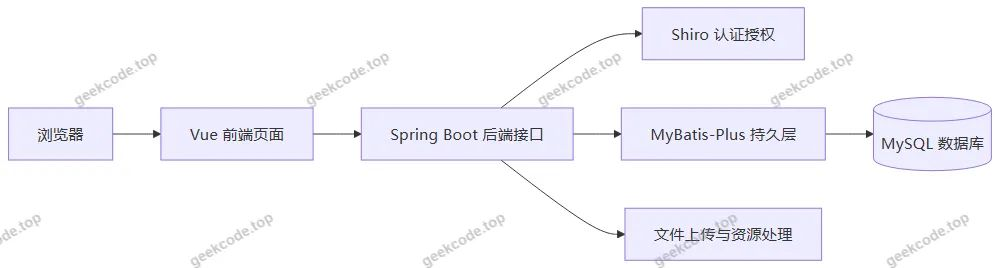</a>

<h3>数据库设计要点</h3>

系统数据库围绕房屋租赁业务链设计，核心业务对象包括用户、房主、房屋类型、房屋信息、我要当房主、预约看房、房屋报修、房屋评价、合同信息、维修处理、公告信息、留言反馈、房屋信息评论、我要当房主评论、我的收藏、系统配置等。

主要数据关系如下：

<ul>
<li>房屋信息关联房屋类型，用于分类展示与筛选。</li>
<li>房屋信息评论关联房屋信息，形成用户互动数据。</li>
<li>我要当房主评论关联我要当房主信息，支持房主入驻或房主展示内容的反馈。</li>
<li>预约看房、房屋报修、房屋评价、合同信息、维修处理围绕房屋、用户、房主形成业务记录。</li>
<li>我的收藏关联用户与业务对象，用于个人收藏管理。</li>
<li>公告信息与留言反馈作为平台公共信息模块，支持前台展示与后台维护。</li>
<li>系统配置模块用于维护平台运行参数。</li>
</ul>
<h3>核心技术选型理由</h3>
<ul>
<li>Spring Boot：作为后端基础框架，提供 Web 服务、依赖管理与应用启动能力，便于快速搭建房屋租赁业务系统。</li>
<li>MyBatis-Plus：用于数据持久层开发，适合处理房屋、用户、评论、收藏、报修、合同等多业务表的数据访问需求。</li>
<li>Shiro：用于登录认证与访问控制，保护后台管理接口与前台个人功能，满足系统安全访问要求。</li>
<li>Vue：用于构建前台用户页面与后台管理页面，提供列表、详情、表单、个人中心等交互界面。</li>
<li>MySQL：用于存储房屋租赁业务中的用户、房屋、预约、报修、评价、合同、评论、收藏、公告、留言等结构化数据。</li>
</ul>
<h2>功能模块</h2>
<h3>前台用户端</h3>
<table>
<thead>
<tr>
<th>功能模块</th>
<th>主要功能描述</th>
</tr>
</thead>
<tbody><tr>
<td>前台首页</td>
<td>展示系统入口、导航菜单与主要业务模块，用户可进入房屋信息、我要当房主、公告信息、留言反馈等页面。</td>
</tr>
<tr>
<td>前台登录页</td>
<td>提供用户登录入口，用于访问个人中心、我的收藏、留言反馈等个人业务功能。</td>
</tr>
<tr>
<td>前台注册页</td>
<td>提供用户注册入口，用于创建前台用户账号。</td>
</tr>
<tr>
<td>房屋信息</td>
<td>展示房屋信息列表与详情，支持查看房屋类型、房屋评价、预约看房、合同信息、维修处理等相关业务内容。</td>
</tr>
<tr>
<td>我要当房主</td>
<td>展示我要当房主列表与详情，支持查看房主入驻或房主展示信息。</td>
</tr>
<tr>
<td>公告信息</td>
<td>展示公告信息列表与详情，用于查看平台通知与公告内容。</td>
</tr>
<tr>
<td>留言反馈</td>
<td>展示留言反馈列表，用于用户查看或提交反馈信息。</td>
</tr>
<tr>
<td>个人中心</td>
<td>提供个人用户信息入口，用于查看和维护当前登录用户相关信息。</td>
</tr>
<tr>
<td>我的收藏</td>
<td>展示用户收藏的房屋或其他业务对象列表，便于个人快速回访。</td>
</tr>
<tr>
<td>房屋信息评论</td>
<td>展示房屋信息评论列表与评论详情，用于查看用户对房屋信息的反馈。</td>
</tr>
<tr>
<td>我要当房主评论</td>
<td>展示我要当房主评论列表与评论详情，用于查看用户对房主入驻或房主展示信息的反馈。</td>
</tr>
<tr>
<td>房屋报修</td>
<td>展示房屋报修列表与详情，用于查看报修业务记录。</td>
</tr>
<tr>
<td>房屋类型</td>
<td>展示房屋类型列表，用于分类浏览房屋资源。</td>
</tr>
<tr>
<td>房屋评价</td>
<td>展示房屋评价列表，用于查看房屋租赁后的评价信息。</td>
</tr>
<tr>
<td>房主列表</td>
<td>展示房主信息列表，用于查看房主相关资料。</td>
</tr>
<tr>
<td>合同信息</td>
<td>展示合同信息列表，用于查看房屋租赁相关合同记录。</td>
</tr>
<tr>
<td>维修处理</td>
<td>展示维修处理列表，用于查看报修后的处理进度或处理记录。</td>
</tr>
<tr>
<td>预约看房</td>
<td>展示预约看房列表，用于查看房屋预约看房记录。</td>
</tr>
</tbody></table>
<h3>后台管理端</h3>
<table>
<thead>
<tr>
<th>功能模块</th>
<th>主要功能描述</th>
</tr>
</thead>
<tbody><tr>
<td>后台登录页</td>
<td>管理员登录入口，用于进入后台管理系统。</td>
</tr>
<tr>
<td>后台首页</td>
<td>展示后台管理主界面，作为各业务模块的统一入口。</td>
</tr>
<tr>
<td>房屋类型</td>
<td>管理房屋类型数据，用于前台房屋分类展示与筛选。</td>
</tr>
<tr>
<td>房屋信息</td>
<td>管理房屋信息数据，维护房屋发布、展示与租赁业务基础信息。</td>
</tr>
<tr>
<td>预约看房</td>
<td>管理预约看房记录，查看用户或房主相关的预约信息。</td>
</tr>
<tr>
<td>房屋报修</td>
<td>管理房屋报修记录，维护报修业务数据。</td>
</tr>
<tr>
<td>合同信息</td>
<td>管理合同信息记录，维护房屋租赁过程中的合同资料。</td>
</tr>
<tr>
<td>维修处理</td>
<td>管理维修处理记录，跟踪房屋报修后的处理情况。</td>
</tr>
<tr>
<td>房屋评价</td>
<td>管理房屋评价数据，查看用户对房屋租赁情况的评价。</td>
</tr>
<tr>
<td>我要当房主</td>
<td>管理我要当房主信息，维护房主入驻或房主展示相关数据。</td>
</tr>
<tr>
<td>房主</td>
<td>管理房主资料，维护房主基础信息。</td>
</tr>
<tr>
<td>用户</td>
<td>管理前台用户资料，维护用户账户信息。</td>
</tr>
<tr>
<td>公告信息</td>
<td>管理公告信息，维护前台展示的通知与公告内容。</td>
</tr>
<tr>
<td>房屋信息评论</td>
<td>管理房屋信息评论数据，维护用户对房屋信息的反馈内容。</td>
</tr>
<tr>
<td>我要当房主评论</td>
<td>管理我要当房主评论数据，维护用户对房主相关信息的反馈内容。</td>
</tr>
<tr>
<td>我的收藏管理</td>
<td>管理用户收藏数据，查看收藏记录与收藏对象。</td>
</tr>
<tr>
<td>留言板管理</td>
<td>管理留言反馈数据，维护前台留言与反馈内容。</td>
</tr>
<tr>
<td>配置文件</td>
<td>管理系统配置参数，维护平台运行相关配置。</td>
</tr>
</tbody></table>
<h2>用户角色与权限</h2>
<table>
<thead>
<tr>
<th>角色</th>
<th>可访问功能模块</th>
<th>权限范围</th>
</tr>
</thead>
<tbody><tr>
<td>管理员</td>
<td>后台登录页、后台首页、房屋类型、房屋信息、预约看房、房屋报修、合同信息、维修处理、房屋评价、我要当房主、房主、用户、公告信息、房屋信息评论、我要当房主评论、我的收藏管理、留言板管理、配置文件</td>
<td>对系统后台全部业务模块进行统一管理，包括房屋、房主、用户、预约、报修、评价、合同、维修、公告、评论、收藏、留言和系统配置等数据。</td>
</tr>
<tr>
<td>普通用户</td>
<td>前台首页、前台登录页、前台注册页、房屋信息、我要当房主、公告信息、留言反馈、个人中心、我的收藏、房屋信息评论、我要当房主评论、房屋报修、房屋类型、房屋评价、房主列表、合同信息、维修处理、预约看房</td>
<td>可浏览前台公开信息，登录后访问个人中心、我的收藏、留言反馈等业务模块，并查看与房屋、房主、预约、报修、评价、合同、维修相关的列表与详情。</td>
</tr>
<tr>
<td>房主</td>
<td>我要当房主、房屋信息、预约看房、房屋报修、房屋评价、合同信息、维修处理、房主列表</td>
<td>作为房屋租赁业务主体参与房主展示、房屋信息、预约看房、报修、评价、合同与维修处理等业务数据关联；相关数据同时可由管理员在后台进行统一维护。</td>
</tr>
</tbody></table>
<h2>项目特色与创新点</h2>
<ul>
<li>业务链条完整：系统覆盖房屋浏览、房主入驻、公告通知、留言反馈、收藏、预约看房、房屋报修、房屋评价、合同信息、维修处理等环节，形成较完整的房屋租赁管理闭环。</li>
<li>前后台协同：前台面向普通用户提供信息浏览与个人业务入口，后台面向管理员提供全量业务数据管理，满足平台运营与用户服务需求。</li>
<li>互动能力丰富：支持房屋信息评论、我要当房主评论、留言反馈、我的收藏等模块，增强用户与房屋、房主、平台信息之间的互动。</li>
<li>数据管理集中：通过后台管理房屋类型、房屋信息、房主、用户、预约、报修、评价、合同、维修、公告、评论、收藏、留言和配置，便于统一维护平台基础数据与业务记录。</li>
<li>文件处理能力：后端提供 FileController，支持系统文件上传与资源处理，为房屋图片、资料或附件等业务场景提供基础能力。</li>
<li>安全访问控制：使用 Shiro 对系统访问进行认证与授权控制，保障后台管理功能与个人用户功能的安全访问。</li>
</ul>
<h2>部署环境</h2>
<table>
<thead>
<tr>
<th>环境组件</th>
<th>用途</th>
</tr>
</thead>
<tbody><tr>
<td>JDK</td>
<td>后端项目编译与运行所需的 Java 运行环境。</td>
</tr>
<tr>
<td>MySQL</td>
<td>存储用户、房主、房屋类型、房屋信息、预约、报修、评价、合同、维修、公告、评论、收藏、留言、配置等业务数据。</td>
</tr>
<tr>
<td>Maven</td>
<td>管理后端项目依赖并完成构建打包。</td>
</tr>
<tr>
<td>Node.js</td>
<td>用于前端项目依赖安装与页面构建，适配 vue-integrated 前后端集成开发方式。</td>
</tr>
<tr>
<td>Spring Boot 内嵌 Web 容器</td>
<td>启动后端服务，提供 HTTP 接口与页面访问能力。</td>
</tr>
<tr>
<td>浏览器</td>
<td>访问前台用户页面与后台管理页面，建议使用 Chrome、Edge、Firefox 等主流浏览器。</td>
</tr>
</tbody></table>
<h2>五、技术特性</h2>
<ul>
<li>前后端集成部署，前端资源打包至后端 static 目录</li>
<li>使用 MyBatis-Plus 简化数据访问层开发</li>
<li>集成 Shiro 权限框架实现角色权限控制</li>
</ul>
<h2>六、功能模块截图</h2>
<h3>前台用户端</h3>
<h4>前台首页</h4>

<a href="https://geekcode.top/archives/%E6%88%BF%E5%B1%8B%E7%A7%9F%E8%B5%81%E7%B3%BB%E7%BB%9F?utm_source=github" title="查看完整源码">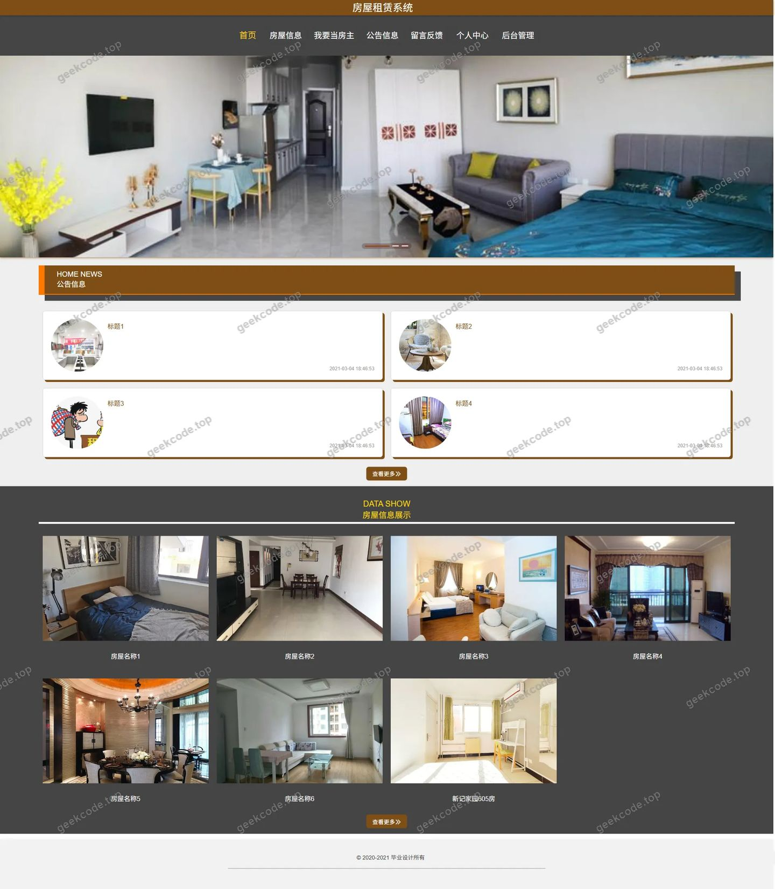</a>

<h4>前台登录页</h4>

<h4>前台注册页</h4>

<a href="https://geekcode.top/archives/%E6%88%BF%E5%B1%8B%E7%A7%9F%E8%B5%81%E7%B3%BB%E7%BB%9F?utm_source=github" title="查看完整源码">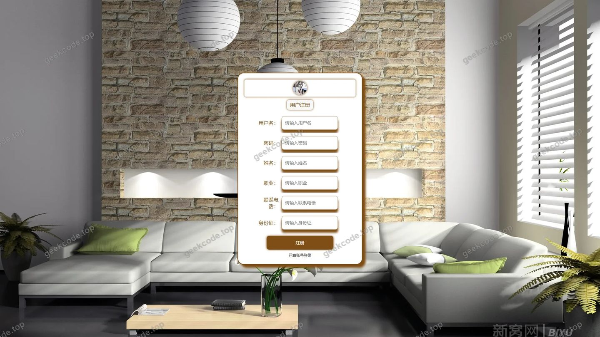</a>

<h4>前台-房屋信息列表</h4>

<a href="https://geekcode.top/archives/%E6%88%BF%E5%B1%8B%E7%A7%9F%E8%B5%81%E7%B3%BB%E7%BB%9F?utm_source=github" title="查看完整源码">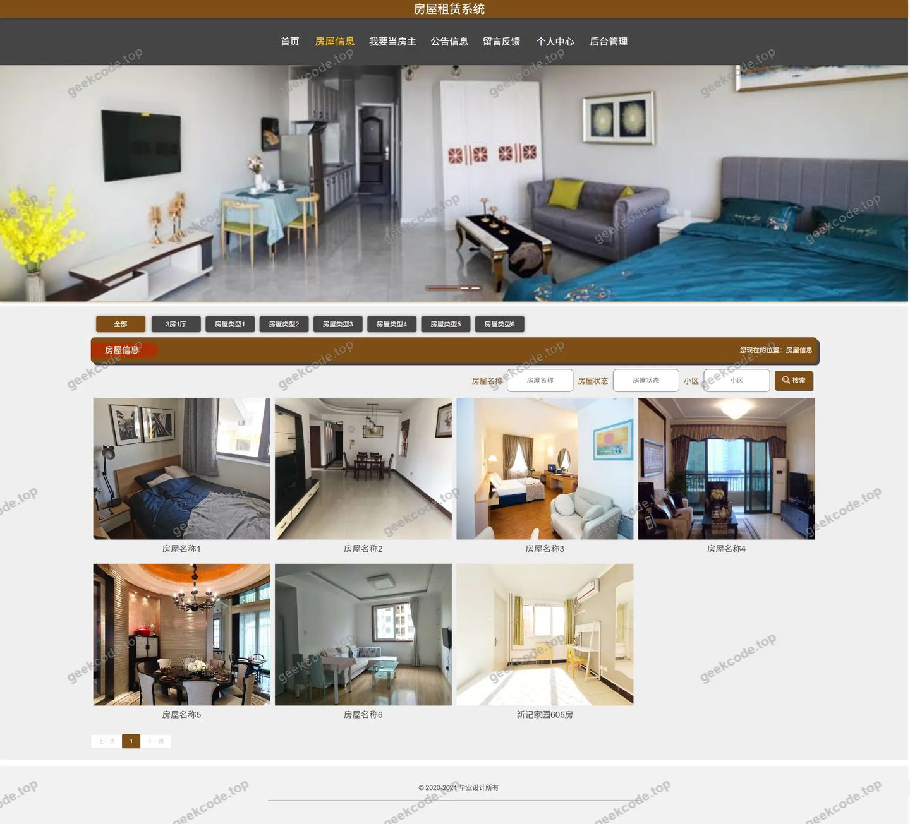</a>

<h4>前台-公告信息列表</h4>

<a href="https://geekcode.top/archives/%E6%88%BF%E5%B1%8B%E7%A7%9F%E8%B5%81%E7%B3%BB%E7%BB%9F?utm_source=github" title="查看完整源码">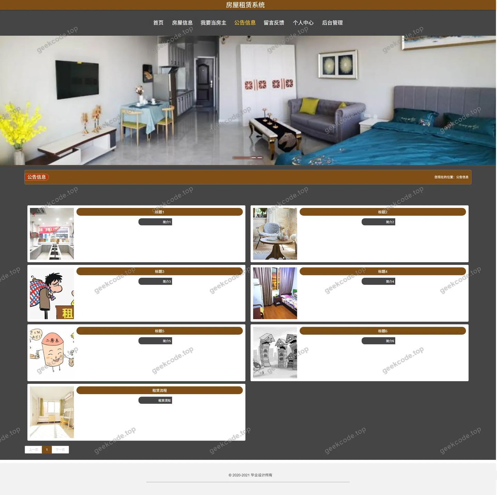</a>

<h4>前台-我要当房主列表</h4>

<a href="https://geekcode.top/archives/%E6%88%BF%E5%B1%8B%E7%A7%9F%E8%B5%81%E7%B3%BB%E7%BB%9F?utm_source=github" title="查看完整源码">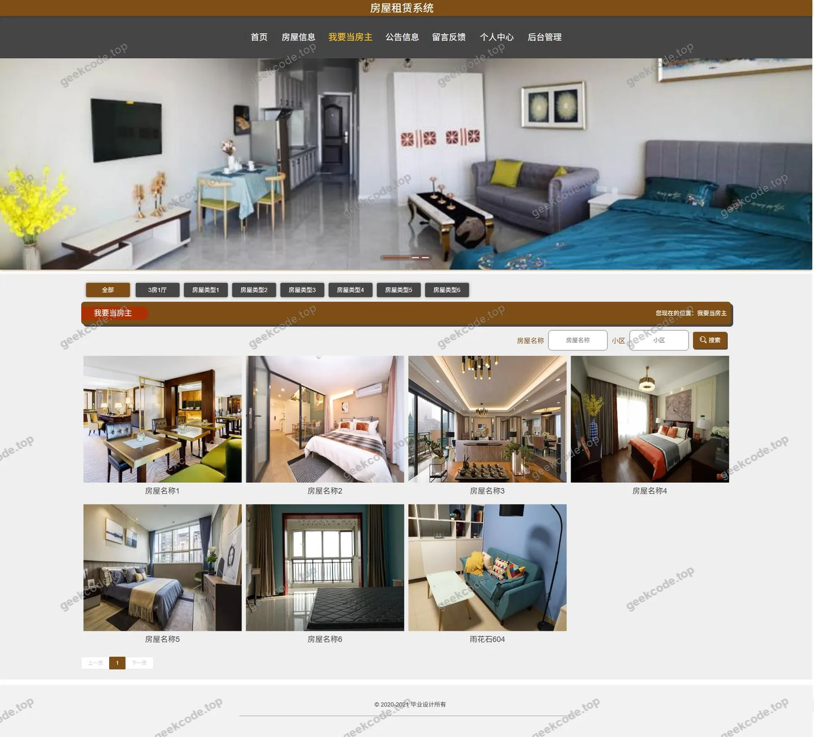</a>

<h4>前台-房屋信息评论列表</h4>

<h4>前台-我要当房主评论列表</h4>

<h4>前台个人中心</h4>

<a href="https://geekcode.top/archives/%E6%88%BF%E5%B1%8B%E7%A7%9F%E8%B5%81%E7%B3%BB%E7%BB%9F?utm_source=github" title="查看完整源码">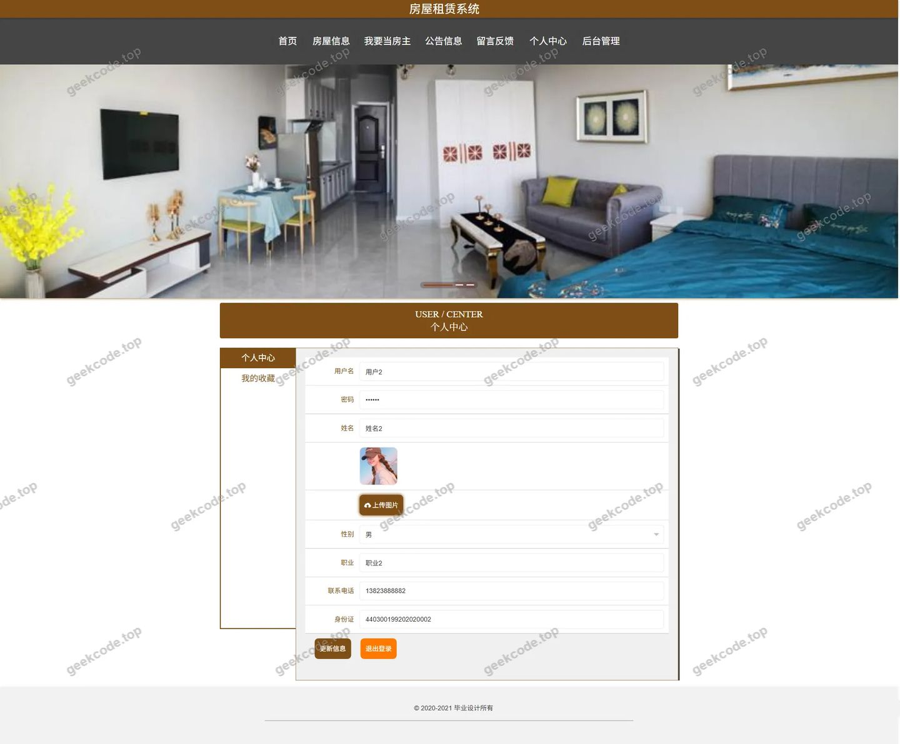</a>

<h4>前台-留言反馈列表</h4>

<a href="https://geekcode.top/archives/%E6%88%BF%E5%B1%8B%E7%A7%9F%E8%B5%81%E7%B3%BB%E7%BB%9F?utm_source=github" title="查看完整源码">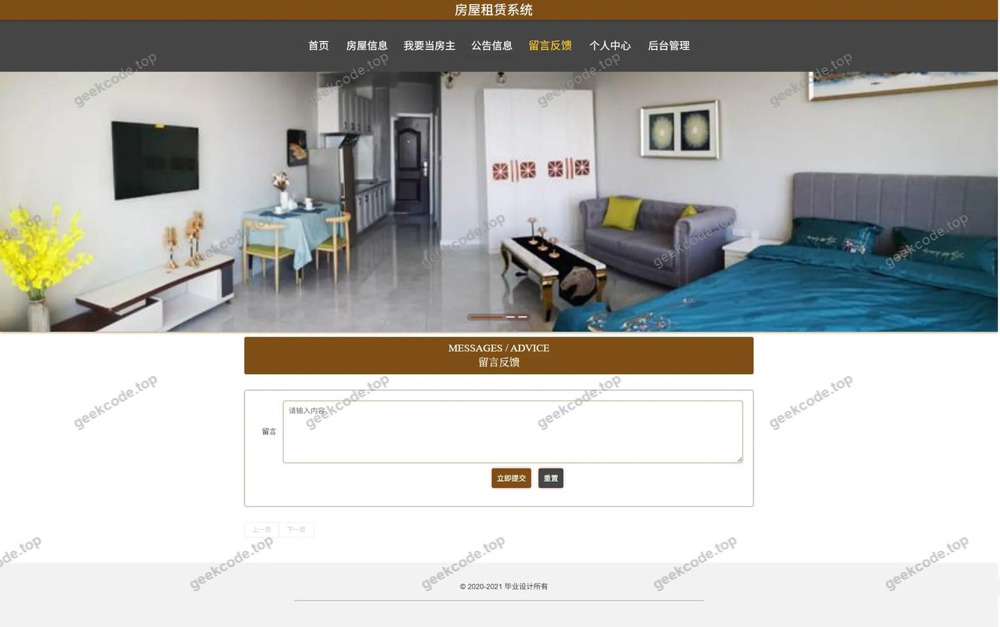</a>

<h4>前台-我的收藏列表</h4>

<a href="https://geekcode.top/archives/%E6%88%BF%E5%B1%8B%E7%A7%9F%E8%B5%81%E7%B3%BB%E7%BB%9F?utm_source=github" title="查看完整源码">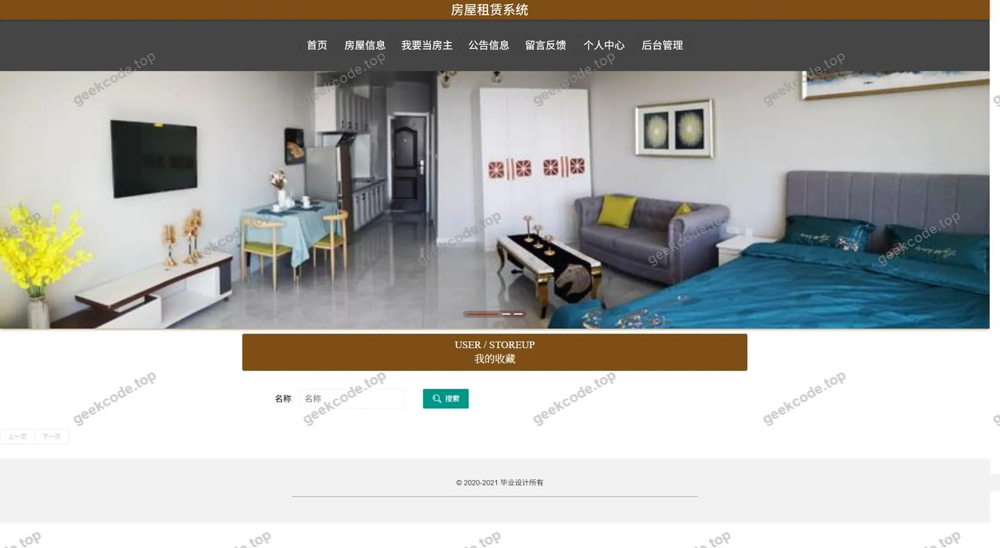</a>

<h4>前台-房屋信息-详情</h4>

<a href="https://geekcode.top/archives/%E6%88%BF%E5%B1%8B%E7%A7%9F%E8%B5%81%E7%B3%BB%E7%BB%9F?utm_source=github" title="查看完整源码">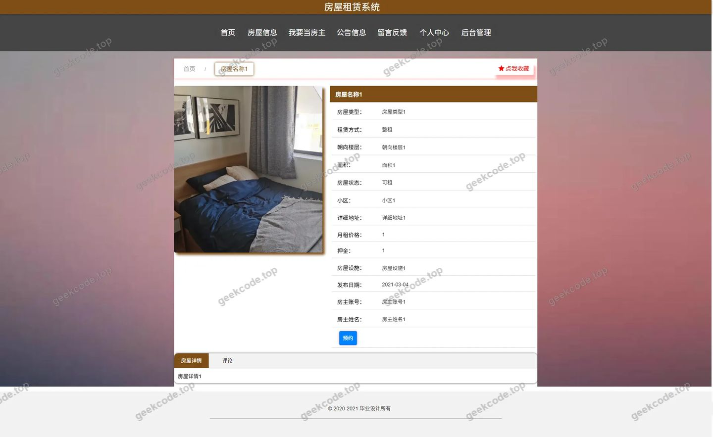</a>

<h4>前台-公告信息-详情</h4>

<a href="https://geekcode.top/archives/%E6%88%BF%E5%B1%8B%E7%A7%9F%E8%B5%81%E7%B3%BB%E7%BB%9F?utm_source=github" title="查看完整源码">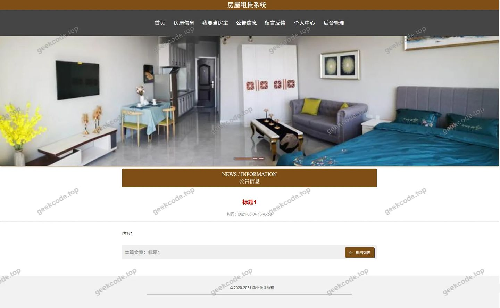</a>

<h4>前台-我要当房主-详情</h4>

<a href="https://geekcode.top/archives/%E6%88%BF%E5%B1%8B%E7%A7%9F%E8%B5%81%E7%B3%BB%E7%BB%9F?utm_source=github" title="查看完整源码">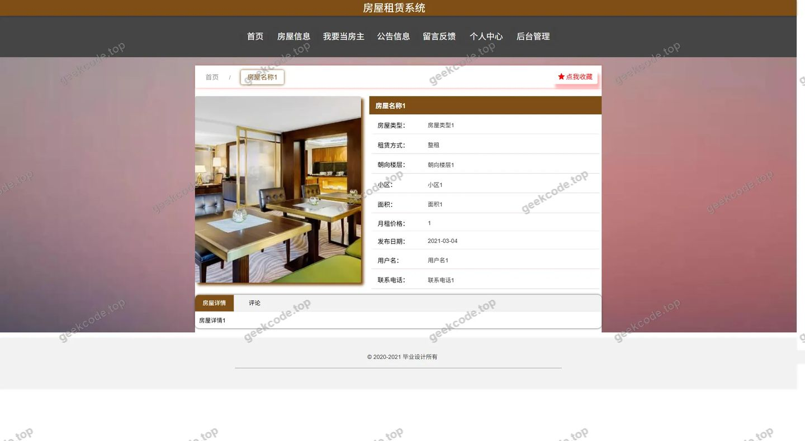</a>

<h4>前台-房屋报修列表</h4>

<h4>前台-房屋类型列表</h4>

<h4>前台-房屋评价列表</h4>

<h4>前台-房主列表</h4>

<h4>前台-合同信息列表</h4>

<h4>前台-维修处理列表</h4>

<a href="https://geekcode.top/archives/%E6%88%BF%E5%B1%8B%E7%A7%9F%E8%B5%81%E7%B3%BB%E7%BB%9F?utm_source=github" title="查看完整源码">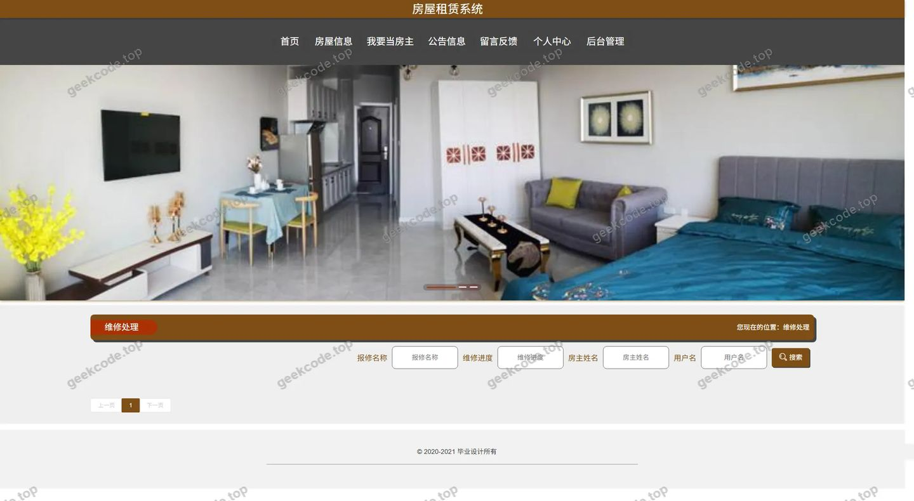</a>

<h4>前台-预约看房列表</h4>

<h4>前台-房屋信息评论-详情</h4>

<a href="https://geekcode.top/archives/%E6%88%BF%E5%B1%8B%E7%A7%9F%E8%B5%81%E7%B3%BB%E7%BB%9F?utm_source=github" title="查看完整源码">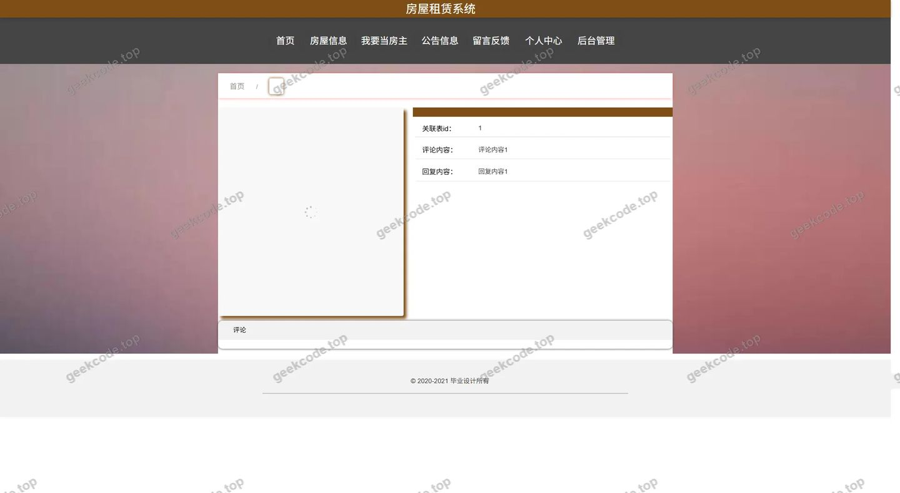</a>

<h4>前台-我要当房主评论-详情</h4>

<h4>前台-房屋报修-详情</h4>

<a href="https://geekcode.top/archives/%E6%88%BF%E5%B1%8B%E7%A7%9F%E8%B5%81%E7%B3%BB%E7%BB%9F?utm_source=github" title="查看完整源码">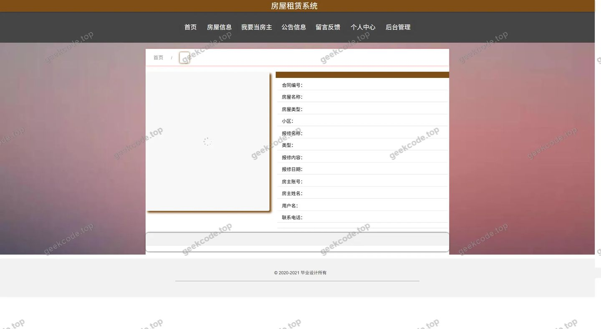</a>

<h3>后台管理端</h3>
<h4>后台-系统配置</h4>

<a href="https://geekcode.top/archives/%E6%88%BF%E5%B1%8B%E7%A7%9F%E8%B5%81%E7%B3%BB%E7%BB%9F?utm_source=github" title="查看完整源码">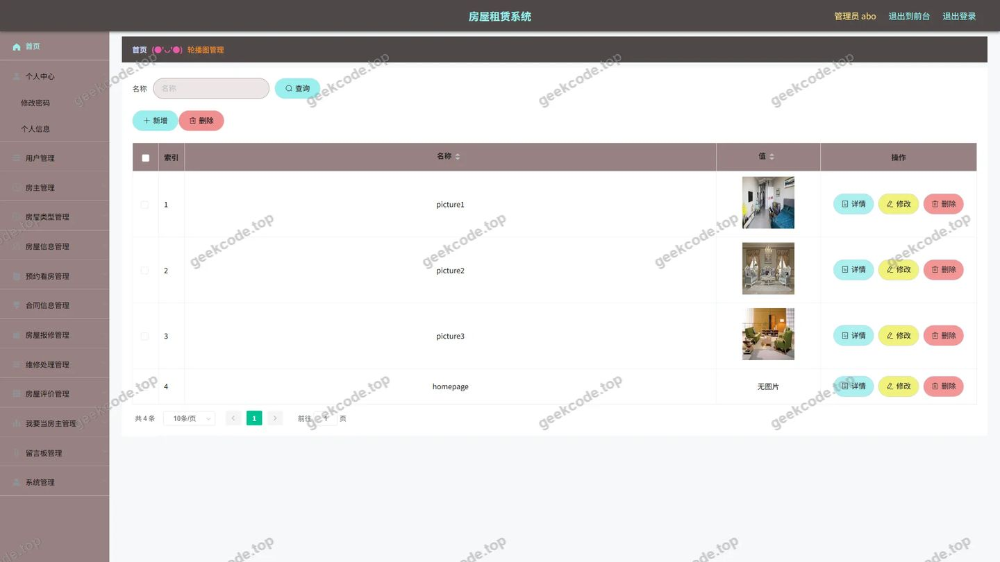</a>

<h4>后台-房屋信息评论</h4>

<a href="https://geekcode.top/archives/%E6%88%BF%E5%B1%8B%E7%A7%9F%E8%B5%81%E7%B3%BB%E7%BB%9F?utm_source=github" title="查看完整源码">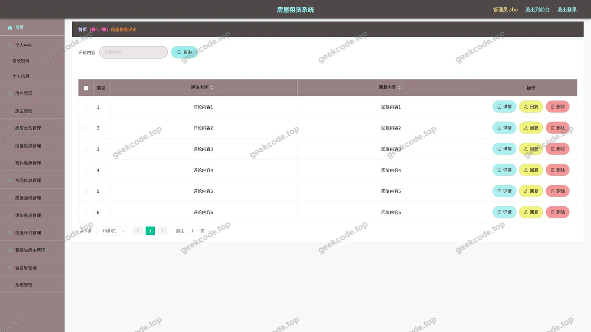</a>

<h4>后台-我要当房主评论</h4>

<a href="https://geekcode.top/archives/%E6%88%BF%E5%B1%8B%E7%A7%9F%E8%B5%81%E7%B3%BB%E7%BB%9F?utm_source=github" title="查看完整源码">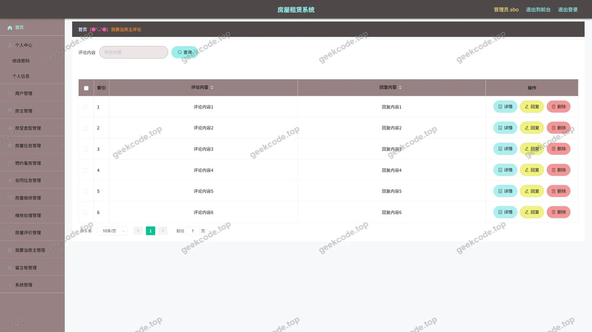</a>

<h4>后台-房屋报修</h4>

<a href="https://geekcode.top/archives/%E6%88%BF%E5%B1%8B%E7%A7%9F%E8%B5%81%E7%B3%BB%E7%BB%9F?utm_source=github" title="查看完整源码">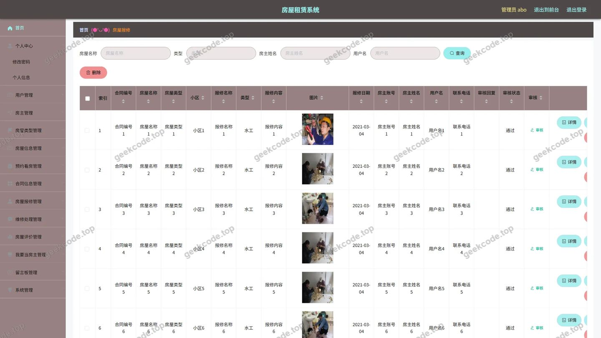</a>

<h4>后台-房屋类型</h4>

<a href="https://geekcode.top/archives/%E6%88%BF%E5%B1%8B%E7%A7%9F%E8%B5%81%E7%B3%BB%E7%BB%9F?utm_source=github" title="查看完整源码">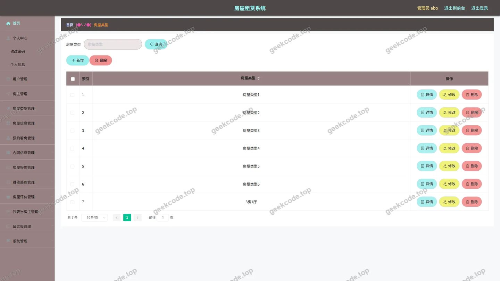</a>

<h4>后台-房屋评价</h4>

<a href="https://geekcode.top/archives/%E6%88%BF%E5%B1%8B%E7%A7%9F%E8%B5%81%E7%B3%BB%E7%BB%9F?utm_source=github" title="查看完整源码">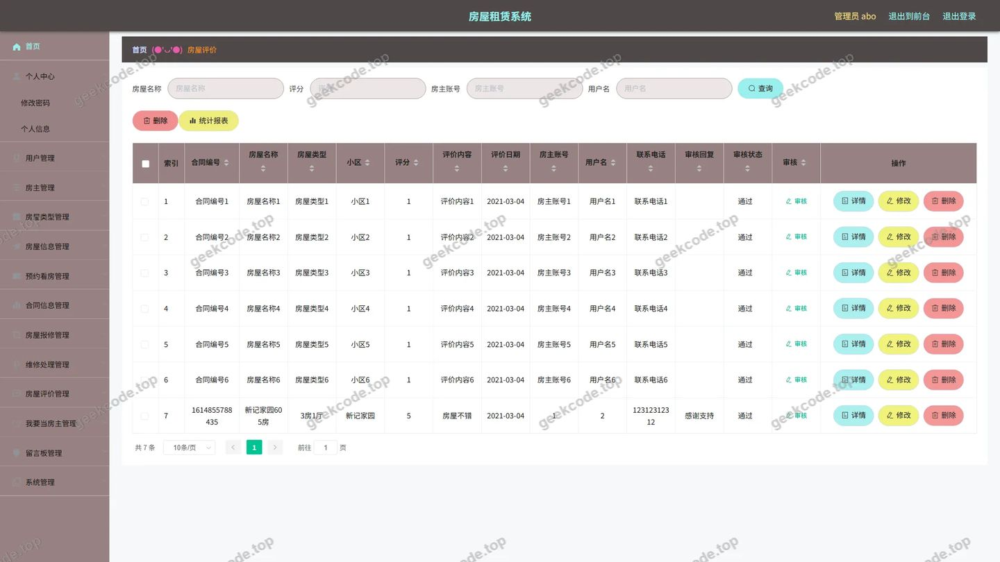</a>

<h4>后台-房屋信息</h4>

<a href="https://geekcode.top/archives/%E6%88%BF%E5%B1%8B%E7%A7%9F%E8%B5%81%E7%B3%BB%E7%BB%9F?utm_source=github" title="查看完整源码">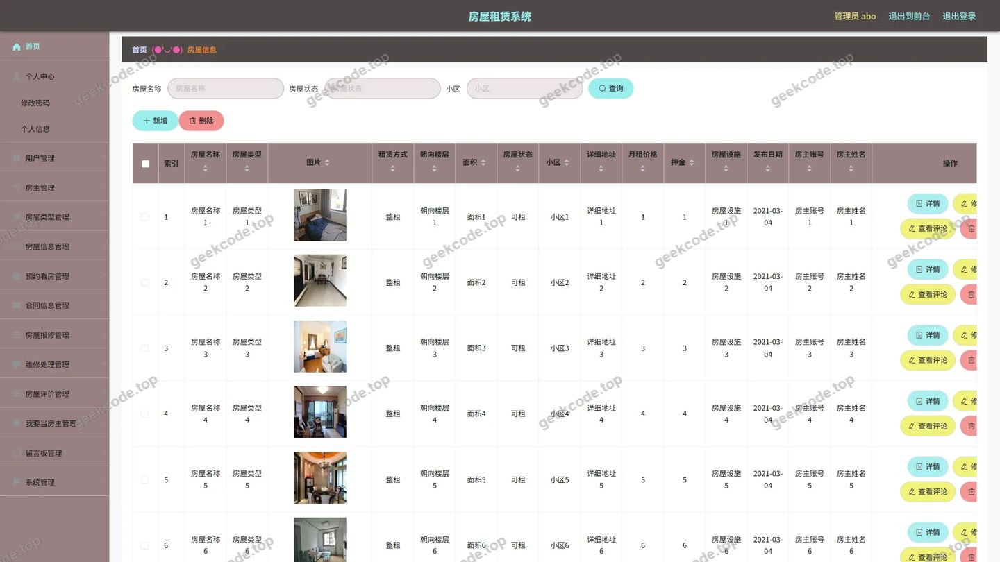</a>

<h4>后台-房主</h4>

<a href="https://geekcode.top/archives/%E6%88%BF%E5%B1%8B%E7%A7%9F%E8%B5%81%E7%B3%BB%E7%BB%9F?utm_source=github" title="查看完整源码">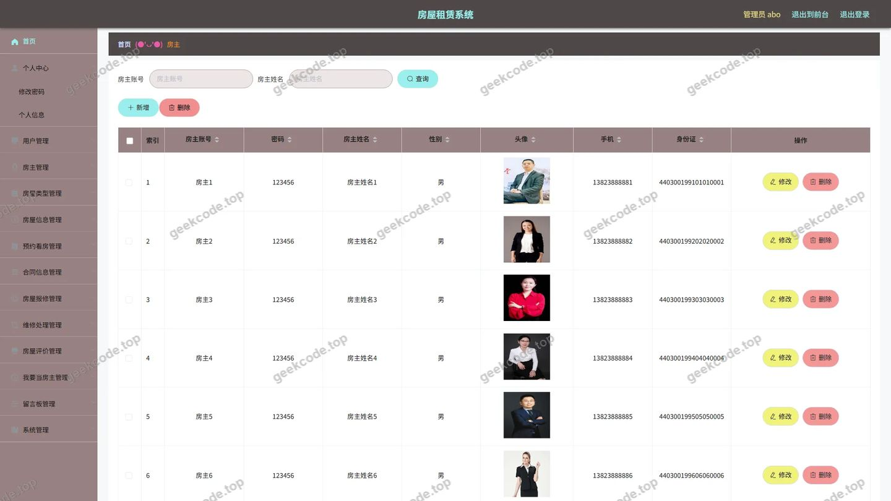</a>

<h4>后台-合同信息</h4>

<a href="https://geekcode.top/archives/%E6%88%BF%E5%B1%8B%E7%A7%9F%E8%B5%81%E7%B3%BB%E7%BB%9F?utm_source=github" title="查看完整源码">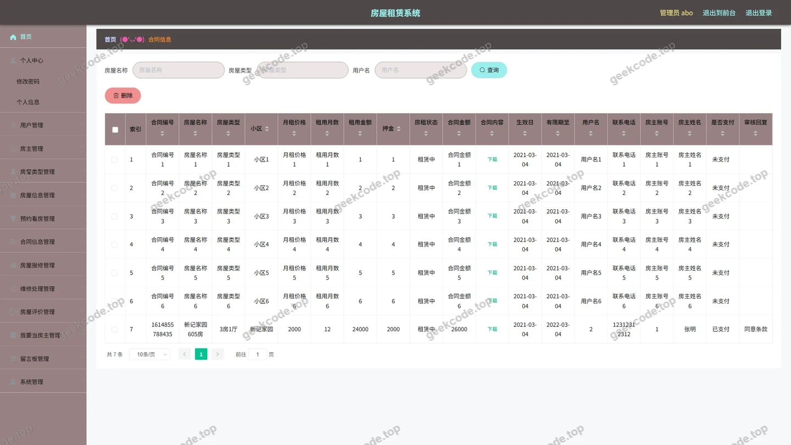</a>

<h4>后台首页</h4>

<a href="https://geekcode.top/archives/%E6%88%BF%E5%B1%8B%E7%A7%9F%E8%B5%81%E7%B3%BB%E7%BB%9F?utm_source=github" title="查看完整源码">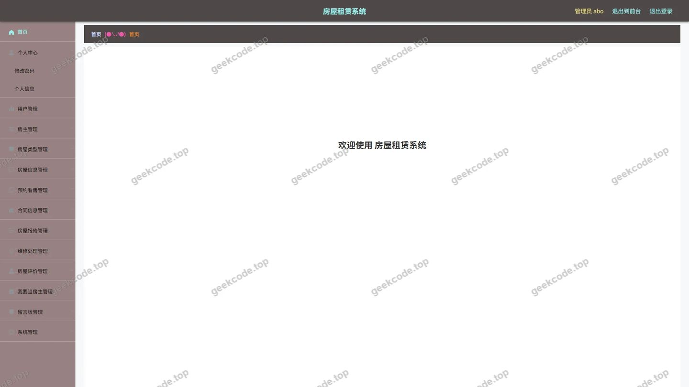</a>

<h4>后台-登录</h4>

<a href="https://geekcode.top/archives/%E6%88%BF%E5%B1%8B%E7%A7%9F%E8%B5%81%E7%B3%BB%E7%BB%9F?utm_source=github" title="查看完整源码">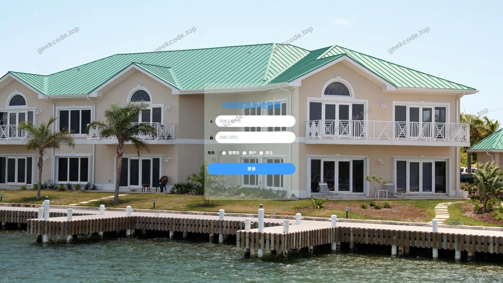</a>

<h4>后台-留言板</h4>

<a href="https://geekcode.top/archives/%E6%88%BF%E5%B1%8B%E7%A7%9F%E8%B5%81%E7%B3%BB%E7%BB%9F?utm_source=github" title="查看完整源码">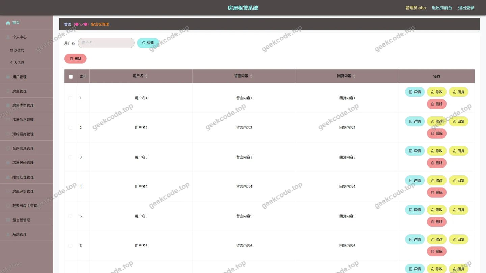</a>

<h4>后台-公告信息</h4>

<a href="https://geekcode.top/archives/%E6%88%BF%E5%B1%8B%E7%A7%9F%E8%B5%81%E7%B3%BB%E7%BB%9F?utm_source=github" title="查看完整源码">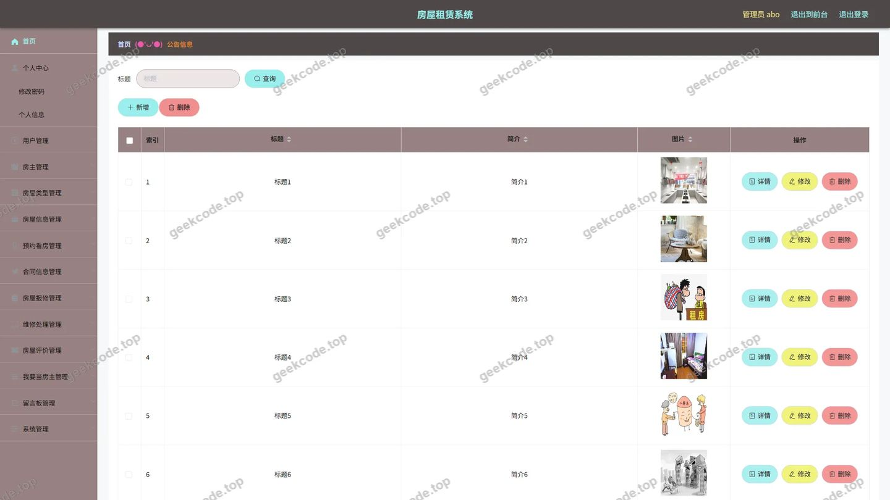</a>

<h4>后台-收藏</h4>

<a href="https://geekcode.top/archives/%E6%88%BF%E5%B1%8B%E7%A7%9F%E8%B5%81%E7%B3%BB%E7%BB%9F?utm_source=github" title="查看完整源码">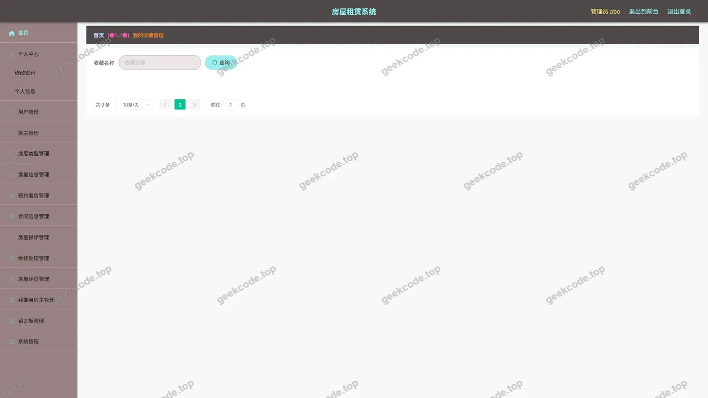</a>

<h4>后台-维修处理</h4>

<a href="https://geekcode.top/archives/%E6%88%BF%E5%B1%8B%E7%A7%9F%E8%B5%81%E7%B3%BB%E7%BB%9F?utm_source=github" title="查看完整源码">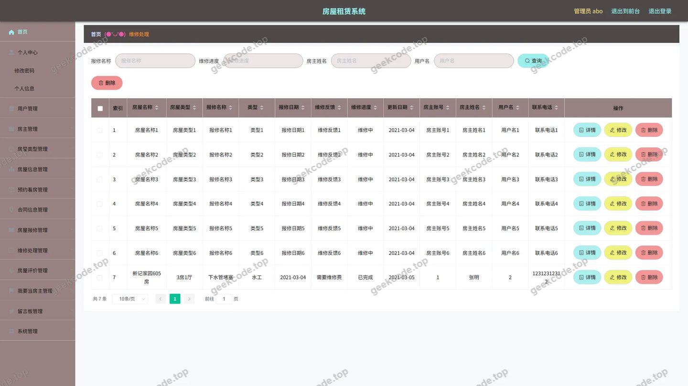</a>

<h4>后台-我要当房主</h4>

<a href="https://geekcode.top/archives/%E6%88%BF%E5%B1%8B%E7%A7%9F%E8%B5%81%E7%B3%BB%E7%BB%9F?utm_source=github" title="查看完整源码">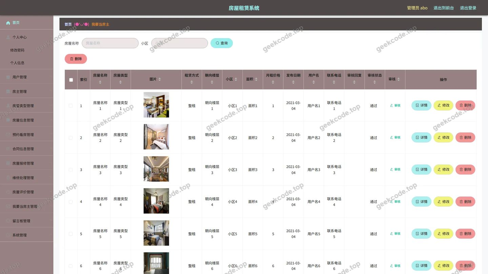</a>

<h4>后台-预约看房</h4>

<a href="https://geekcode.top/archives/%E6%88%BF%E5%B1%8B%E7%A7%9F%E8%B5%81%E7%B3%BB%E7%BB%9F?utm_source=github" title="查看完整源码">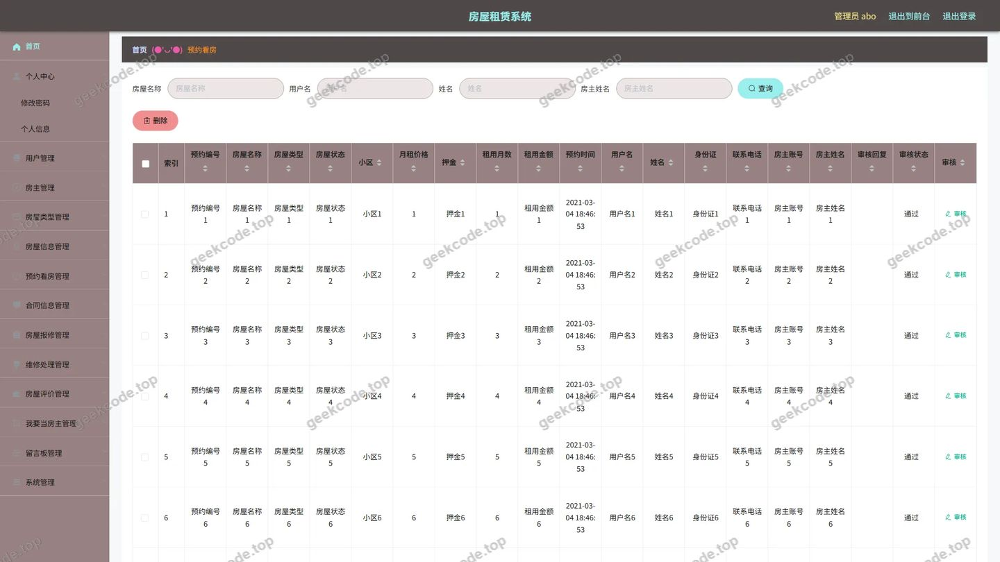</a>

---

## 获取完整源码

| 项目 | 说明 |
| --- | --- |
| 项目名 | 房屋租赁系统 |
| 运行截图 | 本文 42 张（站点带水印原图，仓库 `images/` 目录） |
| 完整源码 | [https://geekcode.top/archives/%E6%88%BF%E5%B1%8B%E7%A7%9F%E8%B5%81%E7%B3%BB%E7%BB%9F?utm_source=github](https://geekcode.top/archives/%E6%88%BF%E5%B1%8B%E7%A7%9F%E8%B5%81%E7%B3%BB%E7%BB%9F?utm_source=github) |
| 咨询微信 | **ir9372**（备注：jingpin-yuanma） |
| 更多项目 | [极客代码 geekcode.top](https://geekcode.top/?utm_source=github) |

> 需要源码、部署、改配置、跑不起来等问题，加微信 ir9372 沟通，说明项目名即可。
